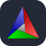

<picture>
  <source media="(prefers-reduced-motion: no-preference)" srcset="assets/visuals/aurora.svg">
  
</picture>

<a href="https://github.com/kong-LrYz?tab=repositories">全部仓库</a> · <a href="https://github.com/kong-LrYz?tab=stars">星标</a>

  <picture>
    <source media="(prefers-color-scheme: dark)" srcset="assets/visuals/contribution-streak-dark-c6596f764d7260f8.svg">
    
  </picture>

  <picture>
    <source media="(prefers-color-scheme: dark)" srcset="assets/visuals/github-stats-dark-878b7d631e725765.svg">
    
  </picture>

  
  
  
  
  
  
  
  

  
  
  
  
  
  
  
  

  
  
  
  
  
  
  
  

  
  
  
  
  
  
  
  

<picture>
  <source media="(prefers-color-scheme: dark)" srcset="assets/visuals/snake-dark.svg">
  
</picture>

组件来自 <a href="https://github.com/jihoo12/github-readme-svg">GitHub Readme SVG</a>、<a href="https://github.com/DenverCoder1/github-readme-streak-stats">Streak Stats</a>、<a href="https://github.com/stats-organization/github-readme-stats">GitHub Readme Stats</a>、<a href="https://github.com/tandpfun/skill-icons">Skill Icons</a>、<a href="https://github.com/raptr45/techstack-generator-plus">TechStack Generator+</a>、<a href="https://github.com/animate-css/animate.css">Animate.css</a>、<a href="https://github.com/saroo98/profile-signal-kit">Profile Signal Kit</a> 和 <a href="https://github.com/Platane/snk">Platane/snk</a>。
