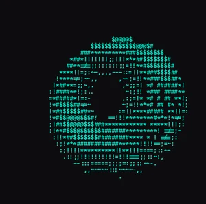

<picture>
  <source media="(prefers-reduced-motion: no-preference)" srcset="assets/visuals/aurora.svg">
  
</picture>

<a href="https://github.com/kong-LrYz?tab=repositories">全部仓库</a> · <a href="https://github.com/kong-LrYz?tab=stars">星标</a>

  

<picture>
  <source media="(prefers-color-scheme: dark)" srcset="assets/visuals/snake-dark.svg">
  
</picture>

  <picture>
    <source media="(prefers-reduced-motion: no-preference)" srcset="assets/visuals/spinning-torus.webp">
    
  </picture>

动效来自 <a href="https://github.com/jihoo12/github-readme-svg">GitHub Readme SVG</a>、<a href="https://github.com/gian-gg/icon-marquee">Icon Marquee</a>、<a href="https://github.com/saroo98/profile-signal-kit">Profile Signal Kit</a>、<a href="https://github.com/Platane/snk">Platane/snk</a> 和 <a href="https://github.com/huytieu/ascii-og">ascii-og</a>。
