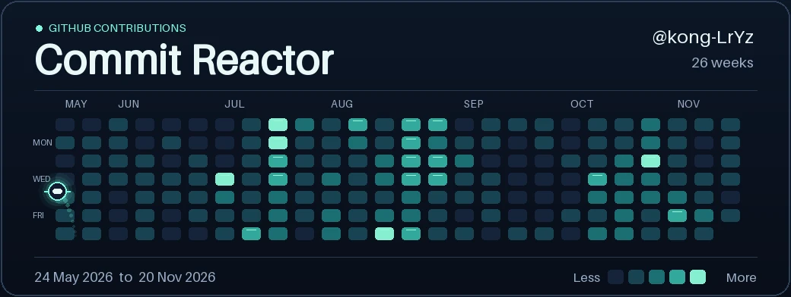

最近更新

<!-- activity:start -->

- [`boss-agent-assistant`](https://github.com/kong-LrYz/boss-agent-assistant) · 2026-10-11
- [`tree-sitter-isabelle`](https://github.com/kong-LrYz/tree-sitter-isabelle) · 2026-04-11
- [`miniOS`](https://github.com/kong-LrYz/miniOS) · 2026-01-28

<!-- activity:end -->

[浏览全部仓库 ↗](https://github.com/kong-LrYz?tab=repositories)

<picture>
  <source media="(prefers-reduced-motion: no-preference)" srcset="assets/reactor-motion.webp" type="image/webp">
  
</picture>
