<picture>
  <source media="(prefers-color-scheme: dark)" srcset="assets/visuals/typing-dark.svg">
  
</picture>

[仓库](https://github.com/kong-LrYz?tab=repositories) · [星标](https://github.com/kong-LrYz?tab=stars)

## 贡献街机

<picture>
  <source media="(prefers-reduced-motion: reduce) and (prefers-color-scheme: dark)" srcset="assets/visuals/circuit-dark.svg">
  <source media="(prefers-reduced-motion: reduce)" srcset="assets/visuals/circuit-light.svg">
  <source media="(prefers-color-scheme: dark)" srcset="assets/visuals/snake-dark.svg">
  
</picture>

## GitHub 节奏

<picture>
  <source media="(prefers-color-scheme: dark)" srcset="assets/visuals/time-dark.svg?style=2">
  
</picture>
<picture>
  <source media="(prefers-color-scheme: dark)" srcset="assets/visuals/languages-dark.svg?style=2">
  
</picture>

## 贡献电路

<picture>
  <source media="(prefers-color-scheme: dark)" srcset="assets/visuals/circuit-dark.svg">
  
</picture>

更多动效 · 星图 / 烟花 / 涟漪

**星图**

<picture>
  <source media="(prefers-color-scheme: dark)" srcset="assets/visuals/constellation-dark.svg">
  
</picture>

**烟花**

<picture>
  <source media="(prefers-color-scheme: dark)" srcset="assets/visuals/fireworks-dark.svg">
  
</picture>

**涟漪**

<picture>
  <source media="(prefers-color-scheme: dark)" srcset="assets/visuals/ripple-dark.svg">
  
</picture>

最近更新

<!-- activity:start -->

- [`boss-agent-assistant`](https://github.com/kong-LrYz/boss-agent-assistant) · 2026-10-11
- [`tree-sitter-isabelle`](https://github.com/kong-LrYz/tree-sitter-isabelle) · 2026-04-11
- [`miniOS`](https://github.com/kong-LrYz/miniOS) · 2026-01-28

<!-- activity:end -->

动效与卡片来自 <a href="https://github.com/DenverCoder1/readme-typing-svg">Readme Typing SVG</a>、<a href="https://github.com/Platane/snk">Platane/snk</a>、<a href="https://github.com/Sur1ive/contribution-fx">Contribution FX</a> 和 <a href="https://github.com/vn7n24fzkq/github-profile-summary-cards">GitHub Profile Summary Cards</a>。
