<picture>
  <source media="(prefers-reduced-motion: no-preference)" srcset="assets/visuals/aurora.svg">
  
</picture>

[全部仓库](https://github.com/kong-LrYz?tab=repositories) · [星标](https://github.com/kong-LrYz?tab=stars)

## 公开项目

  <a href="https://github.com/kong-LrYz/boss-agent-assistant">
    <picture>
      <source media="(prefers-color-scheme: dark)" srcset="assets/visuals/boss-dark.svg">
      
    </picture>
  </a>
  <a href="https://github.com/kong-LrYz/tree-sitter-isabelle">
    <picture>
      <source media="(prefers-color-scheme: dark)" srcset="assets/visuals/parser-dark.svg">
      
    </picture>
  </a>

## 工具与语言

  

## 贡献街机

<picture>
  <source media="(prefers-color-scheme: dark)" srcset="assets/visuals/snake-dark.svg">
  
</picture>

最近更新

<!-- activity:start -->

- [`boss-agent-assistant`](https://github.com/kong-LrYz/boss-agent-assistant) · 2026-10-11
- [`tree-sitter-isabelle`](https://github.com/kong-LrYz/tree-sitter-isabelle) · 2026-04-11
- [`miniOS`](https://github.com/kong-LrYz/miniOS) · 2026-01-28

<!-- activity:end -->

动效与卡片来自 <a href="https://github.com/jihoo12/github-readme-svg">GitHub Readme SVG</a>、<a href="https://github.com/gian-gg/icon-marquee">Icon Marquee</a>、<a href="https://github.com/stats-organization/github-readme-stats">GitHub Readme Stats</a> 和 <a href="https://github.com/Platane/snk">Platane/snk</a>。
